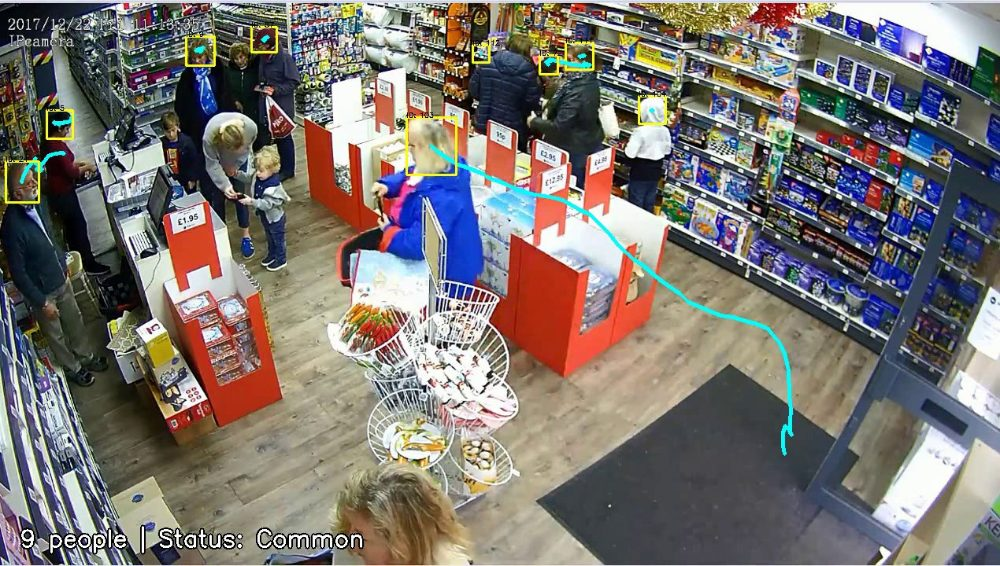

# YOLOv8m Head Detection

YOLOv8m으로 사람 머리 탐지 모델을 전이학습하고 평가하는 작업 공간입니다. 여기서 만든 모델이 [indoor-congestion-analysis](https://github.com/jwhitekim/indoor-congestion-analysis)의 혼잡도 분석에 쓰입니다.



<sub>이 모델을 쓴 indoor-congestion-analysis의 결과 영상(`results/supermaket.mp4`)에서 뽑은 프레임입니다.</sub>

| Precision | Recall | mAP50 | mAP50-95 |
| --- | --- | --- | --- |
| 0.908 | 0.907 | **0.9247** | 0.6768 |

AI-Hub 실내외 군중 데이터(crowd-ah) 기준 기록입니다. 최종 가중치와 이 수치는 indoor-congestion-analysis의 [`models/`](https://github.com/jwhitekim/indoor-congestion-analysis/tree/main/models)에 있고, 이 저장소에는 평가 로그와 가중치가 없습니다.

## 시작하기

Python 3.8 환경과 YOLO 형식의 학습·검증 이미지 및 라벨이 필요합니다. 저장소 루트에서 [`config/custom.yaml`](config/custom.yaml)의 `train`, `val`을 각 이미지 디렉터리의 절대 경로로 지정합니다. 의존성과 초기 가중치(`yolov8m.pt`)를 내려받을 수 있는 인터넷 연결이 필요합니다. 아래 명령은 Linux x86_64와 Bash 기준이며, 의존성 중 `lap==0.4.0`을 빌드하려면 NumPy와 C++ 컴파일러가 먼저 있어야 합니다.

```bash
python -m pip install -r requirements.txt --extra-index-url https://download.pytorch.org/whl/cu118
python - <<'PY'
from ultralytics import YOLO

YOLO("yolov8m.pt").train(
    data="config/custom.yaml", epochs=20, imgsz=640, batch=4,
    optimizer="SGD", lr0=0.01, patience=5, project="results", name="train36",
)
PY
```

학습 결과는 `results/` 아래에 저장됩니다.

## 라이선스

LICENSE 파일이 없습니다. 라이선스는 확인이 필요합니다.
